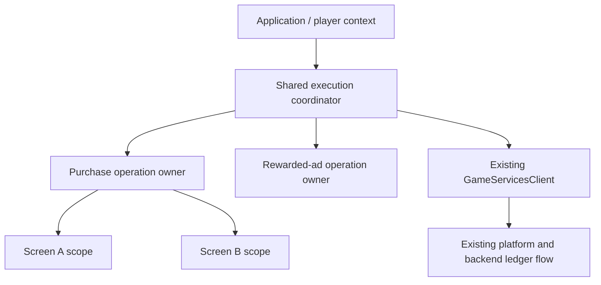

# Game runtime

`@mpgd/game-runtime` coordinates gameplay execution with owned block tokens.
Its headless entrypoints have no Phaser, DOM, network, platform SDK, timer, or polling imports.
It does not change engine state, replace score-oriented `GameSession`, or alter
`PlatformGateway`. Engine and UI consumers apply the requested state separately.

```ts
import { createGameExecutionController } from '@mpgd/game-runtime';

const runtime = createGameExecutionController({ onListenerError: reportError });
const settings = runtime.acquireBlock({
  reason: 'settings', channels: ['simulation', 'gameplay-input'],
});
const background = runtime.acquireBlock({
  reason: 'background', channels: ['simulation', 'gameplay-input', 'audio'],
});
background.release(); // Settings still blocks simulation and gameplay input.
settings.release();   // Those channels may now resume.
runtime.destroy();    // Terminal; this never requests gameplay resume.
```

| Channel | Request |
| --- | --- |
| `simulation` | Stop gameplay simulation updates |
| `gameplay-input` | Block gameplay input, leaving pause/resume UI usable |
| `rendering` | Suppress gameplay rendering according to the engine binding policy |
| `audio` | Mute gameplay audio through an explicit audio sink |

Each channel is blocked while any token includes it. Equal reasons create
independent tokens. Only the returned token can release its block; diagnostic
IDs are local to a controller and cannot be used to release anything. Release
and unsubscribe are idempotent. Keep an additional token for user-confirmed
resume; the core supplies no countdown or automatic resume policy.

`getSnapshot()` returns the same reference until a successful acquisition,
first release, or first destruction. Each increments `version` once, including
changes to token diagnostics that leave the effective channel flags unchanged.
Snapshots, channel flags, token lists, token information, and channel arrays
are frozen. Caller arrays are copied; no consumer object is frozen.

`subscribe` does not emit initially: subscribe, then read `getSnapshot()`.
Listeners run in registration order. Each notification round captures its
snapshot and recipient list. Reentrant state changes are immediate but their
notifications queue behind the current round. Newly registered listeners only
receive future rounds; unsubscribed listeners are skipped even in a captured
round. Read the callback argument for that round's state, since `getSnapshot()`
may already reflect a reentrant change. Duplicate registrations are independent.

Synchronous exceptions and rejected listener promises go to optional
`onListenerError`. Promises are observed without awaiting them. Errors from
that hook are consumed; no global logging or transport is installed. Listeners
must not produce an unbounded cycle of state changes.

`destroy` is terminal and idempotent. It clears owned blocks, emits a terminal
snapshot with every channel blocked, and removes listeners. Destruction also
supersedes outstanding active notification rounds, preventing a stale resume
notification after shutdown. Late token releases are no-ops; new acquisitions
and subscriptions throw. Destroying this coordination object does not terminate
the game process. Consumers must check `status` before applying engine controls.

## Installation and entrypoints

```sh
pnpm add @mpgd/game-runtime
# Only when using the Phaser binding:
pnpm add phaser@^4.2.0
```

| Import | Purpose |
| --- | --- |
| `@mpgd/game-runtime` | Reason-scoped execution controller |
| `@mpgd/game-runtime/ui` | Scoped snapshots, commands and events |
| `@mpgd/game-runtime/platform` | Injected lifecycle source binding |
| `@mpgd/game-runtime/actions` | Purchase and rewarded-ad coordination |
| `@mpgd/game-runtime/presentation` | Shared native full-screen ownership |
| `@mpgd/game-runtime/game` | Game-owned gateway, service, lifecycle and action assembly |
| `@mpgd/game-runtime/audio` | Game-owned audio projection |
| `@mpgd/game-runtime/ads` | Coordinated provider and gateway, injected deadlines and policy |
| `@mpgd/game-runtime/phaser` | Optional gameplay scene binding |

Phaser is an optional peer dependency. The root and headless subpaths do not
re-export the Phaser binding or reference its declarations, so headless consumers
can use them without installing Phaser or enabling DOM types. The action subpath
uses the published `@mpgd/game-services/operations` types; it does not load the
service implementation. Supply the existing game-services client explicitly.

The [Phaser binding guide](./docs/phaser.md) describes scene ownership and cleanup.
This package replaces the kit's two unpublished runtime previews with one public
package. Internal users of `@mpgd/phaser-game-runtime` should switch to
`@mpgd/game-runtime/phaser`. Existing generated games do not gain a dependency or
require migration automatically.

Releases use Sampo changesets and npm Trusted Publishing from
`imjlk/mpgd-kit`'s `.github/workflows/release.yml` after initial npm registration.

Contributor validation: `pnpm --dir packages/game-runtime test`,
`node tools/run-ttsx.mjs tools/package/build-packages.ts @mpgd/game-runtime`,
and `node packages/game-runtime/test/dist-import.mjs`. The package test also
installs packed tarballs in an isolated consumer, checks headless declarations
without DOM types, and checks the optional binding with Phaser declarations.

## Native presentation and financial settlement

Create one `createFullScreenPresentationScope({ execution })` above all screens.
Pass it to `createCoordinatedPlatformGateway` with the original gateway and its
v2 ad provider. Use the returned gateway for both direct platform calls and the
game-services client; pass the same scope and execution controller to
`createGameActionCoordinator`. The coordinator rejects a mismatched controller.

The scope owns simulation, gameplay input, and audio blocks only while native UI
is open or uncertain. Native closure releases that invocation's blocks even
while the game-services client is waiting for a backend claim. Settings and
background blocks remain independently owned. Financial operations retain their
existing duplicate, pending, and reconciliation guards.

An injected advertising deadline ends caller waiting and returns an uncertain
result. It never cancels the native SDK or proves closure. Native close and late
reward observers survive view disposal while needed. `onClaimEvidence` reports
late candidates under the original invocation and idempotency key for an
application-owned claim journal; it cannot grant rewards. Use a durable
game-services operation store when recovery must survive process restart.
`claimEvidence` carries a server proof-lookup correlation without asserting local
SDK eligibility. Registered server verification and its ledger remain authoritative.

Use `createAdClaimEvidenceRecoveryObserver({ recovery, onResult })` to connect
`onClaimEvidence` to an application-owned recoverable monetization client. Bind
the handler during bootstrap before enabling SDK entrypoints. The observer
always forwards an ungranted pending candidate under the original idempotency
key, which may differ from the display invocation ID. Recovery serializes with
the original operation, attaches a newly registered lookup envelope to a pending
journal, and retries its recorded verification request without another SDK call.
Previously recorded evidence and the first journal timestamp remain fixed.
An eligibility change can prompt another lookup under the same identity.
`onResult` observes backend settlement; refresh authoritative state or reconcile
the action coordinator rather than adding rewards directly from SDK callbacks.

The coordinated gateway wraps `gateway.commerce.requestPurchase` (the commerce
provider's purchase call; the v1 `purchase` method no longer exists). A
purchase business result does not prove that native UI closed, so the wrapper
holds a purchase lease only when something trusted can release it: the
provider's own `presentation` facts (a `CommerceProvider` that can prove when
its payment surface closes offers `presentation.subscribe`), the game's
`purchasePresentation` event source, or a `classifyPurchasePresentation`
function. `classifyPurchasePresentation` receives the provider's
`RequestPurchaseResult` (`launched`, `purchased`, `cancelled`, or `failed`),
not a platform `PurchaseResult`, and answers `closed`, `not-started`, or
`unknown`. With none of the three, the wrapper forwards `gateway.commerce`
unchanged and acquires no lease: a result alone would leave presentation
`unknown` for the rest of the session and block every ad. That is how every
commerce provider ran before C4 (only the removed v1 `purchase` was wrapped),
so a store sheet and an ad can overlap on a target without trusted close
facts; wire the provider's `presentation` or a `purchasePresentation` source
to take the lease. A gateway
without a commerce provider stays without one. Events are scoped to the
original idempotency key and a monotonic sequence; late or foreign events cannot
release another invocation. Disposal refuses new calls and retains uncertain
native close observation; `presentation.subscribe` keeps working after it.
Lightweight key history prevents retired purchase keys from reopening the SDK.
It keeps every in-flight, uncertain or retryable key and the last settled
result; once it holds `maxRememberedInvocations` keys (1024 by default), a new
key evicts the oldest settled, closed, non-retryable one. The idempotency key,
`logicalId`, `source`, `offerId`, and `quantity` of a replayed key must match
its first request.

A call the wrapper refuses itself before the provider runs is answered like a
provider's own pre-launch refusal, never as an exception: a `not-started` fact
for the key on `presentation`, then `{ outcome: 'failed' }` with a retryable
error. The error is `IN_PROGRESS` (`storeCode` `PRESENTATION_BUSY`) while
another purchase or ad holds the scope, `NOT_PREPARED`
(`PRESENTATION_DISPOSED`) after disposal, and `IN_PROGRESS`
(`PRESENTATION_HISTORY_FULL`) when every remembered key is still in flight or
retryable. A server-backed reconciler therefore keeps the key and the same key
opens the store later. A changed request under a known key (`key-conflict`), a
settled key (`already-completed`), and `presentation-unavailable` still reject
with `PresentationExecutionError`. `onRefusal` hears each of these refusals
(`busy`, `disposed` or `history-full`, with the key) before its `not-started`
fact; a provider's own failure never reaches it, whatever its codes.
`createCoordinatedPlatformGateway` takes it as `onPurchaseRefusal`.

### Checkout-only hosts

`@mpgd/game-runtime/commerce` exports `createCoordinatedCommerceProvider` for
apps that compose commerce separately from a full gateway or have no advertising
provider. Share the same `FullScreenPresentationScope` with any ads added later.

```ts
import { createCoordinatedCommerceProvider } from '@mpgd/game-runtime/commerce';

const commerce = createCoordinatedCommerceProvider({
  provider: nativeCommerce,
  presentation: appPresentation,
  // Omit if nativeCommerce.presentation already provides trusted native facts.
  purchasePresentation: nativePurchaseSurface,
});
// Feed commerce to the existing server-backed purchase reconciler.
// At app-owner teardown (not on every view change):
commerce.dispose();
```

Unlike the legacy gateway's compatibility pass-through, this standalone API
rejects new checkout with `PresentationExecutionError.code ===
'presentation-unavailable'` when neither native facts nor a trusted classifier
are supplied. Catalog reads, unfinished-purchase recovery, transaction events
and finalization still forward with their original receiver. Do not install an
empty event source to bypass this gate: once launched, an unknown sheet retains
its lease until a matching native close/non-launch observation arrives, even
after the business promise rejects or the wrapper is disposed.

The returned provider exposes the selected native facts and trusted classifier
observations through `presentation.subscribe`, so a server-backed reconciler can
retain a proven unopened, retryable attempt in its durable requested state.
Only a retryable failure with a trusted `not-started` fact may start a new flight
under the same unchanged identity. That fact still releases the key when it
arrives after the provider has already returned the retryable failure, including
when the provider rejects with `retryable: true` instead of resolving a failed
result. A purchased, launched, opened, or non-retryable result does not reopen,
and the fact never grants. A provider that restarts its native sequence echoes
the attempt generation on the request so a delayed event from the previous
attempt cannot release the next sheet. Concurrent calls still coalesce; changed
arguments and uncertain/opened outcomes never reopen checkout. Published event
sequences increase across retries even when a native provider restarts its own
sequence for each call. A fact that arrives after the reconciler has journaled
`failed` does not reopen that record.

This extracts the existing gateway coordinator; gateway behavior remains
compatible. It does not add Billing/StoreKit native close events, treat app
resume or transaction callbacks as closure, or grant currency. Games using
plugins without such events must keep new checkout disabled until their host
implements and verifies those facts. Server verification, fulfillment and
persistent receipt idempotency remain owned by game-services.

`canShow` is an injected placement policy. No target-specific branch belongs in
the game flow. Availability and preparation gate SDK calls; a shared busy surface
blocks purchases, rewarded ads, and interstitials together. The adapter-level
SDK conformance suites certify each provider separately from these runtime tests.

## Scoped UI bridge

`@mpgd/game-runtime/ui` is a separate, headless entrypoint. Importing the root
execution controller does not load the UI bridge. The bridge separates persistent
snapshots, user-intent commands, and one-time events. Multiple command handlers
are allowed and run in registration order; dispatch is not a success result or
proof that a purchase or reward was granted. Events have no replay or history.

```ts
import { createGameUiBridge } from '@mpgd/game-runtime/ui';

const bridge = createGameUiBridge<
  { count: number }, { type: 'refresh' }, { type: 'refreshed' }
>({ initialSnapshot: { count: 0 }, onListenerError: reportError });
const screen = bridge.createScope();
screen.subscribeSelector((state) => state.count, renderCount);
renderCount(bridge.getSnapshot().count); // Subscriptions do not emit initially.
screen.onCommand(async () => {
  const count = await readCount();
  screen.setSnapshot({ count });
  screen.emit({ type: 'refreshed' });
});
screen.dispatch({ type: 'refresh' });
screen.dispose(); // A later readCount result cannot update this or a new screen.
```

`getSnapshot()` remains referentially stable until `setSnapshot` receives a value
that differs under `Object.is`. Snapshots and command/event payloads belong to the
consumer: publish immutable values and replace changed state. The bridge neither
deep-clones nor freezes arbitrary consumer or engine objects. Only bridge and
scope API containers are frozen; listener lists and pending deliveries stay
private. There is no frame-based copying, timer, or global singleton.

`subscribeSelector(selector, listener, equality = Object.is)` evaluates its
initial selection without notifying. Unchanged selected values suppress delivery.
Selectors and equality functions must be pure. Initial selector failures reject
registration; subsequent selector, equality, or listener failures are isolated
and reported through `onListenerError`. A failed selection leaves the previous
selection intact. An invoked listener receives the new selection even if another
listener changed current state reentrantly.

All notifications share one FIFO delivery queue. Each dispatch captures its
value and recipients. Reentrant mutations update current state immediately, but
their notifications run after the current round. Unsubscribed recipients are
skipped and new registrations wait for future dispatches. Duplicate registrations
are independent. As with the execution controller, synchronous exceptions and
rejected promises are observed without awaiting; errors from the optional error
hook are consumed. Observation failure never converts a business operation into
failure. Avoid self-sustaining dispatch cycles.

Scopes own subscriptions and cleanup via `own(cleanup)`. Its returned function
releases that resource once, and removes it from the scope's retained cleanup
set. Disposal first revokes callback and commit permission, then runs registered
cleanups in registration order. Cleanup errors do not prevent remaining cleanup.
An asynchronously acquired resource passed to `own` after disposal is immediately
released. This is the one deliberately supported late registration; ordinary new
subscriptions on a disposed scope throw.

After disposal, scoped `setSnapshot`, `emit`, and `dispatch` return `false`.
They cannot affect another screen scope. Raw bridge methods are application-owner
APIs; passing those directly to a screen's asynchronous work bypasses this guard.
Scope disposal does not cancel a request, server verification, or reward claim.
Such business operations need an owner whose lifetime exceeds the screen.

Bridge destruction disposes all scopes, removes listeners and queued deliveries,
and rejects new registration, dispatch, emit, or setSnapshot calls. The final
snapshot remains readable. Disposal, destruction, and unsubscribe are idempotent;
late scoped commits still return `false` after bridge destruction.

The UI subpath is part of the published package. Changes to its public contract
or runtime behavior require a Sampo changeset for `@mpgd/game-runtime`.

## Platform lifecycle binding

Import `bindGameLifecycle` from `@mpgd/game-runtime/platform`. Supply a controller,
a minimal `source` with `onPause`/`onResume` subscriptions (compatible with
`PlatformGateway.lifecycle`), and either an explicit `initialState` or a
`readState()` callback. States are `active`, `inactive`, and `unknown`; unknown
conservatively blocks. Default channels are all four execution channels.

Subscriptions install before reading current state. Events received during
installation override an explicit initial state; an event during `readState`
overrides that read's return value. A readable source should return its current
state synchronously. No DOM or SDK is imported and LifecycleAdapter is unchanged.

Each binding owns at most one token. Duplicate pause/resume events are idempotent;
a resume cannot release settings or another source's block. `dispose()` removes
subscriptions and releases only its own token. Source callbacks captured before
disposal become harmless, and controller destruction automatically detaches the
binding. Setup failures clean installed subscriptions; optional `onError` observes
cleanup errors without preventing remaining cleanup.

```ts
const lifecycleBinding = bindGameLifecycle({
  controller: runtime,
  source: gateway.lifecycle,
  initialState: 'unknown',
});
// A later source resume can release this binding's conservative startup block.
lifecycleBinding.dispose();
```

## Purchase and rewarded-ad actions

`@mpgd/game-runtime/actions` provides `createGameActionCoordinator`,
`createPurchaseActionController` and `createRewardedAdActionController`. Inject the
existing `GameServicesClient` (or its DOM-free `GameServicesOperationClient` port).
The controllers call only `purchase` and `claimRewardedAd`; they do not call an SDK,
verify a receipt, retry a transaction or grant local currency.

```ts
import { createGameExecutionController } from '@mpgd/game-runtime';
import { createGameActionCoordinator } from '@mpgd/game-runtime/actions';
import { createGameUiBridge } from '@mpgd/game-runtime/ui';

// Application lifetime: one coordinator per runtime/client/player context.
const execution = createGameExecutionController();
const coordinator = createGameActionCoordinator({ execution, client });
const purchase = coordinator.createPurchaseController();
const ui = createGameUiBridge<string, never, string>({ initialSnapshot: 'idle' });
const screen = ui.createScope();
const view = purchase.bindScope(screen, {
  snapshot: (value) => value.status,
  event: (value) => `purchase:${value.status}`,
});
const result = view.execute({ productId: 'example', source: 'shop', idempotencyKey: suppliedKey });
screen.dispose(); // Detaches this screen; the service invocation and its block continue.
await result; // The owner also retains its safe completion snapshot through getSnapshot().
```



An owner outlives its views. `subscribe` observes safe owner snapshots without an
initial delivery. `bindScope` projects only operations explicitly executed or joined
through that view; merely opening screen B never subscribes B to screen A's old
completion. Scope disposal removes UI subscriptions and commit authority. It does
not cancel the service promise. Owner `dispose` rejects new executions and removes
owner UI listeners, but preserves the eventual snapshot of an already started
operation. Coordinator disposal prevents new work across its owners. Neither
kind of disposal claims to roll back an external purchase.

| State | Meaning and handling |
| --- | --- |
| `idle` | No operation observed by this owner. |
| `running` | Local service call in flight; optional `progress` is a real service observation. |
| `granted` | Existing service result reports a grant. Read authoritative economy state through existing APIs. |
| `cancelled` (purchase), `skipped` (ad) | Preserve the service outcome. No automatic retry. |
| `pending` (purchase) | Unresolved transaction; local gameplay block ends, reconciliation is still required. |
| `unavailable` (ad) | Service cannot provide this ad. |
| `rejected` / `failed` | Preserve these distinct service outcomes; no local grant and no automatic retry. |
| `exception` | Call threw; final transaction result is unknown. Original error rejects the returned Promise, not the UI snapshot. |

Snapshots contain only kind, status, coordinator-local operation ID and whitelisted
progress fields. They never contain receipt/evidence, raw server bodies, ledger
objects, player identity or provider error text. Progress does not prove grant or
native UI visibility/closure. A legacy client that ignores options stays `running`
until its result settles. Listener and projection errors, including rejected async
listeners, are isolated through `onObserverError`.

Each local invocation owns a simulation/gameplay-input token from before the service
call until settlement. Settings/background tokens remain independent. No timer,
SDK-visibility guess, polling or `Promise.race` releases a block early. A `pending`
result releases this local block but is not considered a cancelled transaction.

The coordinator serializes purchases and ads for its injected client. Identical
in-flight keys/inputs share the exact Promise across recreated owners. A key reused
with a different kind, product, source or placement rejects with `key-conflict`.
Different in-flight work rejects with `busy`. The most recent completed operation
can be explicitly observed again through the retained Promise; earlier completed
keys reject with `already-completed` and are never re-invoked.

Only input fingerprints are remembered, at most `maxRememberedKeys` (default 1024,
allowed 1–10000). Keys are never evicted silently: reaching the bound rejects new
keys with `history-full`. The coordinator retains at most one completed result
Promise, not an unbounded result/event log. It is scoped to the current process;
server ledger idempotency remains authoritative. Creating another coordinator or
restarting the process is outside this guarantee. Do not recreate it per screen or
to bypass unresolved work, and do not generate a new key for each UI retry.

`getAvailability()` answers whether a new action can start now: `disposed`,
`reconciliation-required`, `busy`, `history-full` or `ready`, checked in that
order, which is the order in which `execute` refuses a new key.
`subscribeAvailability(listener)` hears each change, with no initial delivery
(read `getAvailability()` after subscribing), in order also to listeners that
reenter, and ends with `disposed`. The coordinator watches the execution
controller and the scope only while at least one listener is subscribed, and
never after `disposed`; subscribing after disposal throws `disposed`. Use it to disable a buy or watch
button instead of polling.

Given a `presentation` scope, the coordinator is also `busy` while any
presentation owns that scope, including a purchase started outside the actions
(a game shop or a reconciler calling the coordinated gateway's
`commerce.requestPurchase`). It leaves `busy` when that purchase's `closed` or
`not-started` fact releases the lease: to `ready`, or to
`reconciliation-required` or `history-full` when an earlier action left that
state. A store answer alone leaves the lease `unknown` and the coordinator
`busy`. An action started meanwhile
rejects with `busy` before the service call, so its key is not remembered and
the same key can run later.

The preflight runs when the action is reserved, and the coordinated store takes
the scope one microtask after a `requestPurchase` call, so another purchase can
still take the scope after the check and before the action's own store call
(also one requested earlier in the same turn). The coordinated store then
refuses the action's call before its provider runs. Given `purchaseRefusals`
(the runtime wires the coordinator's `onRefusal` there), the action answers
any such refusal as the preflight would: it rejects with the same code
(`busy`, `history-full` or `disposed`), forgets the key and returns to `idle`.
It does so only when the coordinator itself refused this action's key during
the call and the service result is exactly that refusal: a `failed` purchase
that never launched (no transaction, evidence, verification or ledger entry)
whose diagnostic is the coordinator's own answer, retryable (`IN_PROGRESS` /
`PRESENTATION_BUSY`, `IN_PROGRESS` / `PRESENTATION_HISTORY_FULL`, or
`NOT_PREPARED` / `PRESENTATION_DISPOSED`). Both sides read these answers from
one definition (`coordinatorRefusalAnswers` and `matchCoordinatorRefusal`,
exported from `@mpgd/game-runtime/commerce`). A store's own failure, even with
the same codes, settles `failed` as before. The server-backed reconciler keeps
that key retryable, so the same key opens the store later.

The actions do not take the purchase's claim on the scope themselves at
reservation, which would close this window at its source: the service client
may do asynchronous work (a session, a reconciler start) before the store call,
so the claim would freeze the game, audio included, with no sheet on screen;
and the claim could only be handed to the commerce coordinator through the
client, which does not carry it (a legacy client, a plain gateway without sheet
facts, or a client built on another gateway would never release or adopt it).

**Behaviour change on a gateway without an ad provider.** Before, an action
purchase started while another purchase held the screen resolved `failed`
(the store's `PRESENTATION_BUSY` refusal) and its key was spent: retrying it
replayed the failure, and later rejected with `already-completed`. It now
rejects with `GameActionExecutionError` `busy` and keeps its key, as with an
ad provider.

`actionBlock` chooses when each action holds its own simulation/gameplay-input
block from before the service call until its result. The default,
`'without-presentation'`, holds it only without a `presentation` scope: with
one, the client's purchases and rewarded ads take the scope's leases instead
(a client backed by `createCoordinatedPlatformGateway` sharing the scope).
`'always'` holds it with a scope too, for a client whose rewarded ads take no
lease; the scope then only gates.

After `pending` or an invoked operation exception, new keys reject with
`reconciliation-required`. Configure an optional `reconciliation` port to connect
existing provider/backend recovery to this coordinator. `getPendingOperation()`
returns its frozen invocation identity. `reconcile()` joins concurrent calls into
one recovery query; it never calls `purchase` or `claimRewardedAd` again.
The recovery adapter must not await `coordinator.reconcile()` itself: that joins
the same in-flight query and creates a wait cycle.

```ts
const coordinator = createGameActionCoordinator({
  execution,
  client, // permanently bound to authenticatedPlayerId
  reconciliation: {
    playerId: authenticatedPlayerId,
    async recover(operation) {
      // Application port: query/recover the original operation using your existing
      // authenticated backend and saved evidence. This is not a bundled HTTP API.
      const transaction = await recoveryBackend.findCommittedGrant(operation);
      if (!transaction || transaction.source === 'admin') return undefined;
      return { operationId: operation.operationId, transaction };
    },
  },
});
const recovery = await coordinator.reconcile();
if (recovery.status === 'reconciled') {
  // Refresh authoritative entitlements. Do not grant locally from this notification.
  await refreshEntitlements();
}
```

The transaction shape is a structural subset of game-services
`ProductGrantTransaction`: `playerId`, `source`, `grantId`, `idempotencyKey` and
`ledgerEntryId`. The port is a trusted application integration boundary, like the
operation client itself. It must return an authenticated, committed backend grant,
not a platform callback or a receipt supplied by the UI. The coordinator checks
player, local operation number, purchase/ad source, logical product/placement and
original idempotency key before unlocking. It does not authenticate a server or
verify receipt signatures itself. Keep the port and client bound to the same
player and recreate the application runtime on account change; do not change a
client's player behind an existing coordinator.

`undefined` means still pending, a query error preserves the operation, and
mismatched/malformed identity rejects with `invalid-reconciliation`. No port gives
`reconciliation-unavailable`. With no unconfirmed operation, the result is
`not-required`. Disposal or execution destruction prevents a late query result
from being applied. Reconciliation owns no gameplay block.

This first connection resolves **confirmed ledger grants only**. An empty lookup,
a negative verification response, a timeout, cancellation or retryable provider
hint cannot prove terminal non-grant and cannot unlock the coordinator. Such
cases retain the conservative recovery requirement. There is no reset or automatic
repurchase. This API does not add a recovery service or durable operation storage;
those remain with the existing application/backend recovery policy.

Successful reconciliation clears the unconfirmed operation but retains key
history and the original Promise. That Promise still carries its original
pending result/exception; controller snapshots and detached UI scopes are not
rewritten by recovery. Use the reconciliation result to refresh the current UI.
The same key never starts a second service call and `history-full` still applies.
Input/preflight scheduling rejections occur before the service call and do not
invent a business outcome.

Packaging: `/actions` uses **type-only** imports from `@mpgd/game-services/operations`.
The workspace dependency ensures declarations/build order; neither the basic
runtime import nor actions import loads the service implementation, Phaser or DOM.
The headless consumer checks declarations with `skipLibCheck: false` and only
ES2022 globals. The published service dependency supplies the `/operations` port
and progress options without requiring DOM types. Changes to the public action
contract or runtime behavior require a Sampo changeset for `@mpgd/game-runtime`.
Generated games opt into this package explicitly.

The owner that reserves an operation controls its pre-invocation startup permission.
A reentrant same-key joiner cannot cancel that owner's startup by disposing itself.
If owner/runtime disposal prevents any client invocation, the flight rejects with
a scheduling error, resets its observed state to `idle`, and emits no business
completion/exception event. An invoked client failure remains `exception`.

## Game-owned platform assembly

Create one `createGamePlatformRuntime` from `@mpgd/game-runtime/game` during
bootstrap. Pass the original gateway, an explicit initial lifecycle state,
a game policy, optional injected wait deadline, and `createServices(gateway)`.
The services factory must use the supplied coordinated gateway. Its structural
ports keep this subpath independent of DOM, Phaser, network and schema imports,
while preserving target-specific gateway extensions and concrete service types.

A versioned provider installs one shared scope for purchases, rewarded ads and
interstitials. Legacy gateways retain their existing surface and coarse action
blocking. V2 rewarded display is disabled until the services expose
`monetizationRecovery`: the application must supply a durable, atomic,
encrypted operation store rather than a memory fallback. Startup and resume
reconcile existing records without opening SDK UI. Account changes require a
new client/runtime bound to that account.

A game without an ad provider (`gateway.ads.provider` absent, for example a
Capacitor shell with no ads plugin) still gets purchase coordination when
something trusted can end a purchase: the commerce provider's `presentation`
facts or the runtime's `purchasePresentation` input. `runtime.gateway.commerce`
is then a `createCoordinatedCommerceProvider` over the same scope, so a
purchase owns `runtime.presentation` (`kind: 'purchase'`) and blocks
simulation, gameplay input and audio from the request until the sheet's
`closed` (or `not-started`) fact. A business result alone leaves the lease
`unknown`, a second purchase is refused while the sheet is up (a retryable
`IN_PROGRESS` failure after a `not-started` fact, so its key stays usable), and
a settled key never reopens the sheet. `runtime.actions` keeps its own block
there, through server verification, because a legacy rewarded ad on such a
gateway takes no lease (`actionBlock: 'always'`). With or without an ad
provider, `runtime.actions` is `busy` (`getAvailability()`,
`subscribeAvailability`) while any purchase holds the scope, one started
outside the actions included, unless an earlier action is still unconfirmed:
then it reports `reconciliation-required` instead, and a new action rejects
with that code. Otherwise an action started meanwhile rejects with
`busy` without spending its key, also when the other purchase takes the screen
just before the action's own store call (see `purchaseRefusals` above). This
replaces the earlier answer without an ad provider, a resolved `failed` result
that spent the key. A commerce provider without facts (an adapter or
plugin built before them) keeps the plain gateway and today's behavior; it
never meets the standalone coordinator's `presentation-unavailable` refusal.
On the Capacitor gateway this adds to, and does not replace, the gateway's own
lifecycle pause, which also follows the facts. The lease has no timeout of its
own: it ends on the provider's facts, so a provider that offers
`presentation` must end every call with `closed` or `not-started` (the
Capacitor store provider does, after 15 minutes at the latest). As with an ad
provider, `runtime.gateway` is then a forwarding view of the gateway, not the
same object, and reads `gateway.commerce` once at construction.

Keep the runtime above scenes. Create scene-owned action controllers from
`runtime.actions`; dispose those controllers and their input listeners on
scene shutdown. After an await, check the captured controller's disposal state
before touching scene objects. A trusted `reconciliation` port can unlock new
financial keys only after reading the matching authoritative ledger grant.
The original key/history remains retired and never becomes an SDK retry.

Late registered candidates reach `recoverRewardResult` under the original
operation idempotency key. `onLateResult` also exposes provider settlement
that follows a caller deadline. The game assembly journals a definitive
not-started/non-earned result only when no prior candidate was observed;
previous proof/request identity is never replaced by a negative callback.
Native closure and business settlement remain independent, including during
runtime teardown. Purchase results still require native `purchasePresentation`
facts to prove physical closure; a business success alone remains unknown.

Bind `bindGameAudio({ execution, sink })` once to the game's sound manager.
Scenes use `bindPhaserGameScene({ audioOwner: 'game', ... })` and never supply
a competing scene audio sink. Scene shutdown therefore cannot unmute a live
native presentation or release background/settings ownership. Disposing an
audio projection while blocked leaves mute in place. Destroy execution on game
teardown before detaching the audio projection. Express additional user mute
ownership with an audio execution block.

The AIT SDK/host/proxy integration test combines this assembly with the real
client recovery, registered independent verifier and replay-safe ledger. It
proves late evidence after view disposal, pending authority with zero grants,
authoritative settlement, immutable request/timestamp reuse, proof replay
rejection and reconstructed-client recovery with one SDK show. Its memory
journal/ledger are test fixtures, not production persistence or live Toss
certification.

`actions.confirmRecoveredRewardResult(key, result)` accepts only a trusted
journal recovery's confirmed non-grant result for a matching rewarded action.
It can retire a late SDK preparation failure or a definitive server rejection,
while preserving original key history and any live native lease. Foreign keys,
purchase actions, pending results and grant-shaped results cannot be unlocked
through this path. Positive grants continue through the authoritative ledger
reconciliation port. This method never updates a disposed view or opens UI.

## Scene-owned DOM banners

`@mpgd/game-runtime/dom` is an opt-in browser entrypoint. It consumes the canonical
`PlatformGateway.ads` banner methods and imports no platform SDK. The root and
other headless entrypoints retain their engine- and DOM-free declaration contracts.

```ts
import { createInlineBannerManager } from '@mpgd/game-runtime/dom';

const banner = createInlineBannerManager({
  gameRoot, ads: gateway.ads, enabled: bannerEnabled,
  placementId: 'FOOTER', surfaceId: 'footer-ad', label: 'Advertisement',
  layoutClassName: 'banner-layout', surfaceClassName: 'banner-surface',
  stateDataKey: 'bannerState',
});
const release = banner.acquire({ onLayoutChange: resizeGame });
// Scene shutdown: release(); final game teardown: banner.destroy();
```

Each mount adds an opaque unique suffix to the supplied surface namespace. The
provider receives that actual DOM ID. A newer acquisition replaces the parent
slot's previous owner (disposing a displaced manager), and a stale release or provider response only cleans up
its own native surface. Layout is `loading` until the provider confirms `mounted`;
style only the mounted state to reserve banner height. Unavailable/failed results
collapse the surface and rely on the provider's terminal cleanup contract. The
helper never selects placements, enables a target, supplies fallback advertising,
or grants rewards.

Page restoration renews the current acquisition, including hosts that do not use
BFCache. Lifecycle listeners and elements use the game root's own document/window
so embedded surfaces work independently. Release and destroy are idempotent;
layout observer errors cannot interrupt cleanup and can be observed through
`onObserverError`. The consumer owns CSS, banner dimensions, eligibility, and
scene shutdown wiring. Importing the module creates no DOM or lifecycle listeners.

## Impact feedback

The opt-in `./impact` and `./phaser/impact` entries provide deterministic recipe
matching and scene-owned pooled rendering. See [configuration and gotchas](docs/impact-feedback.md).

[Standalone commerce verification record](docs/2026-10-20-standalone-commerce.md).
